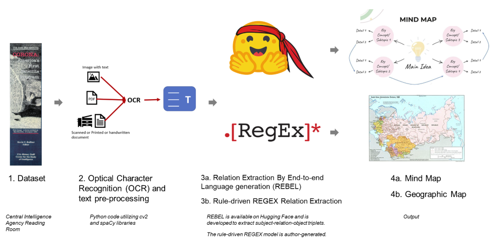
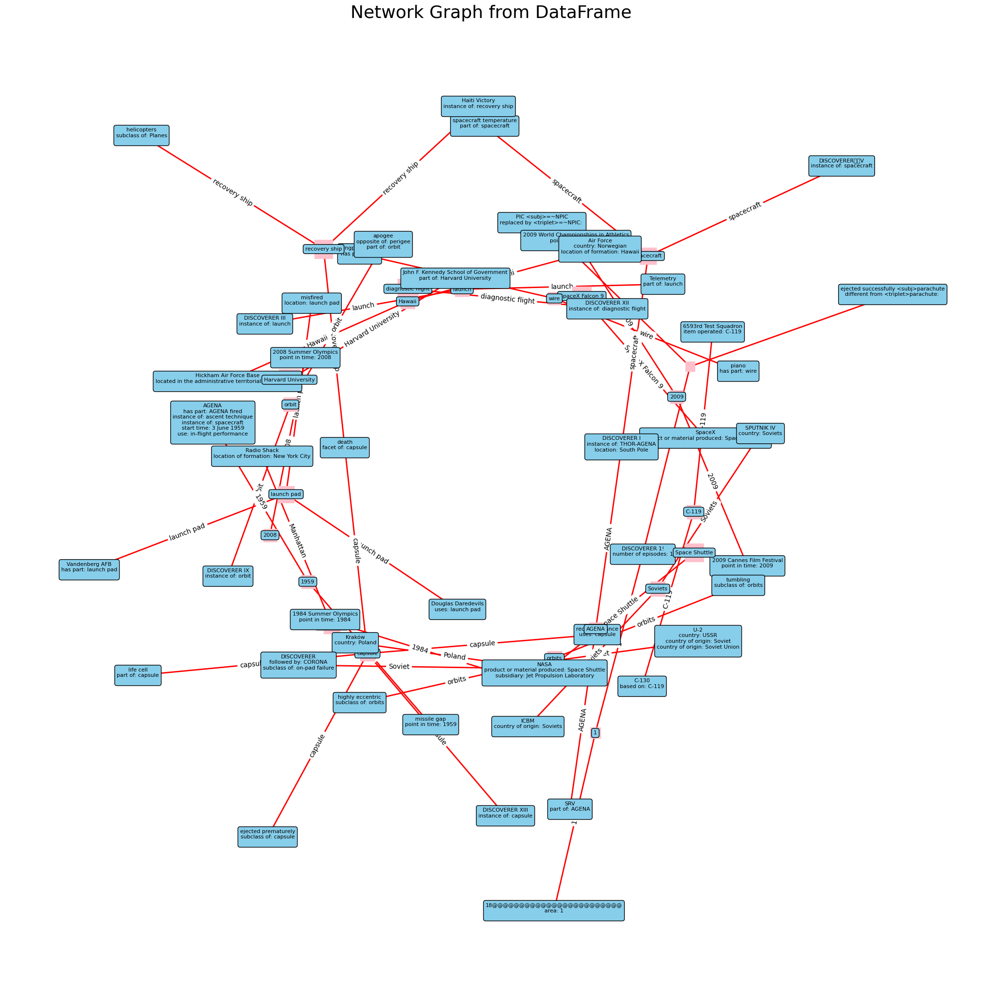
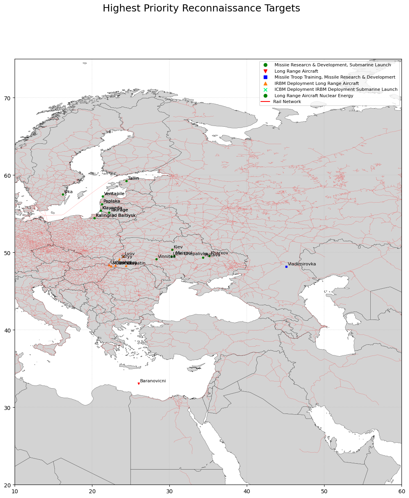
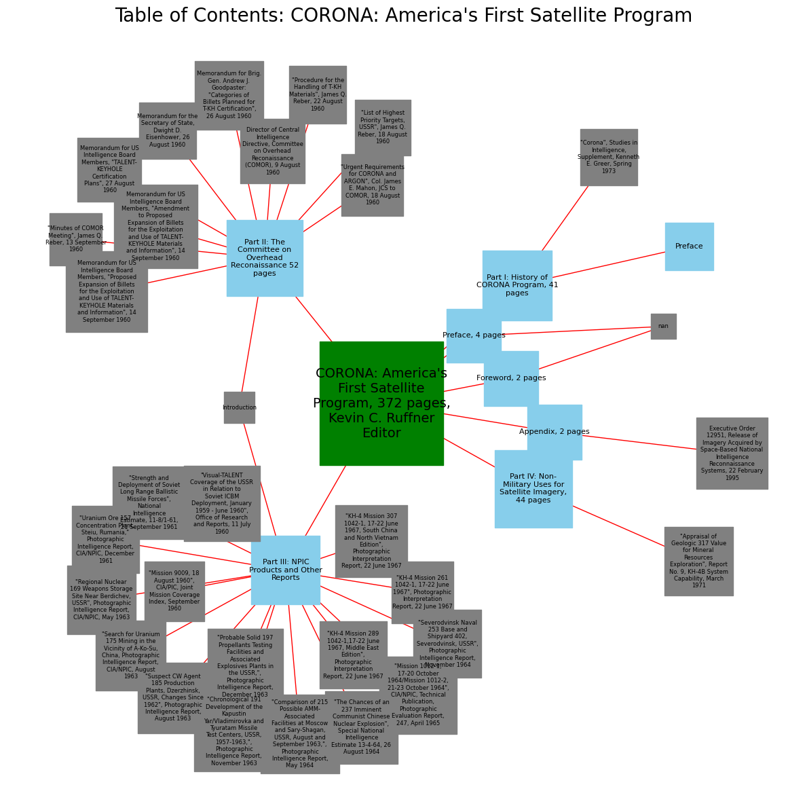
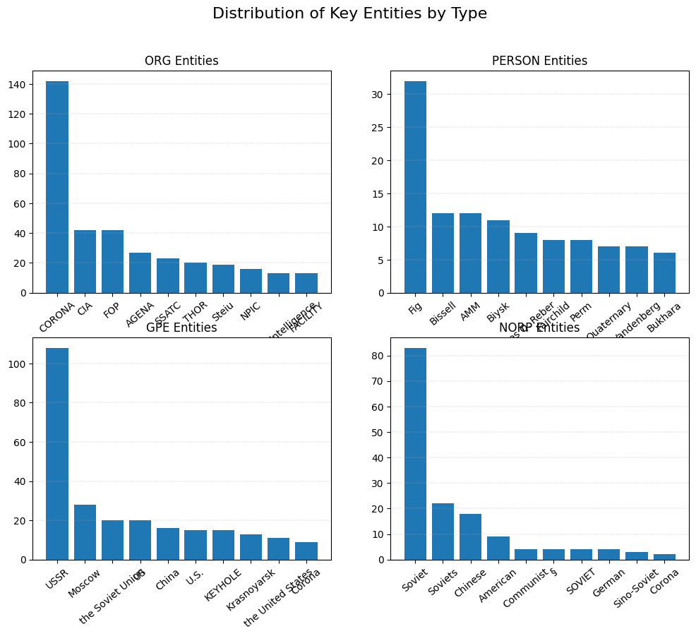

# Decoding CORONA: Turning Declassified CIA Archives into a Knowledge Graph

**Harvard Extension School · CSCI 89B Natural Language Processing · Fall 2025 · Michael Benning**

[▶ Project video](https://youtu.be/eObFeQRcBFU) · [📄 Full project report (PDF)](docs/Decoding_CORONA_Project_Report.pdf) · [📓 Notebook](notebooks/Decoding_CORONA.ipynb)

---

## The problem

The CIA's *CORONA: America's First Satellite Program* is a 372-page collection of scanned, heavily redacted Cold War memos, intelligence estimates, photo-interpretation reports and target lists. None of it is machine-readable. The goal was to turn it into structured knowledge (**who and what is related to whom, and how**) without hand-labeling a single example.

**Why it matters outside the archive:** replace "Cold War intelligence files" with "decades of scanned maintenance logs, engineering change orders, inspection reports or supplier PDFs", and this is the same problem most industrial companies have with their legacy documents. The approach here, digitize, extract entities and relationships, then visualize, is a template for unlocking that knowledge.

## What I built

An end-to-end pipeline from scanned PDF to knowledge graph and maps:



1. **OCR and document splitting.** Image preprocessing (grayscale and thresholding with OpenCV) and Tesseract OCR digitize the scanned pages. A table-of-contents spec then splits the corpus into stand-alone documents while skipping figures and photos.
2. **Corpus analytics.** spaCy sentence segmentation and named-entity recognition profile the corpus by document length and entity type.
3. **Relation extraction (machine learning).** The [REBEL](https://huggingface.co/Babelscape/rebel-large) transformer (BART-based, Hugging Face) generates *(head, relation, tail)* triplets, for example *(CORONA, service entry, August 1960)*. I compared two input strategies: whole sentences vs. entity-bounded phrases.
4. **Relation extraction (rules).** Some documents are lists and tables, where the model fails, such as the *List of Highest Priority Targets, USSR*. For those, a custom regex extractor pulls target names, coordinates and target categories.
5. **Visual outputs.** networkx "mind maps" show the extracted knowledge. geopandas maps plot Soviet ICBM-deployment and missile R&D target sites.

## Results and takeaways

- **The objective was met.** Relationship triplets were extracted across the corpus and rendered as readable knowledge graphs and geographic maps.
- **Sentence inputs beat phrase inputs.** Phrases surfaced more relationships but also more noise (for example *August 1960 → point in time → August 1960*). That fits how REBEL was trained, on sentences.
- **Match the method to the data.** Narrative documents suit a transformer. Tables and lists need rules. A hybrid pipeline beat either approach alone.
- **Off-the-shelf NER has domain blind spots.** Only 2 of spaCy's 10 most frequent "PERSON" entities were real people, so domain fine-tuning is the clear next step.

| Knowledge graph (sentence-based triplets) | Extracted target locations |
|---|---|
|  |  |

| Corpus table of contents as a mind map | Named entities by type |
|---|---|
|  |  |

## What I'd do next

- Clean the OCR output (redactions, strike-throughs and handwriting) and improve OCR on degraded pages.
- Fine-tune spaCy NER and REBEL on corpus-specific examples.
- Improve graph readability for large documents.

## Tech stack

Python · Tesseract OCR (pytesseract, pdf2image) · OpenCV · spaCy · Hugging Face Transformers (REBEL / BART) · pandas · networkx · geopandas · Google Colab (GPU)

## Repository layout

```
notebooks/Decoding_CORONA.ipynb   Full pipeline, with outputs
images/                           Pipeline diagram, mind maps, target maps
docs/                             Project report (PDF)
requirements.txt                  Python and system dependencies
```

## Running it

The notebook was built in Google Colab with a GPU runtime and reads its inputs from Google Drive (`/content/drive/MyDrive/89B Project Data Files/`):

1. Download the source PDF from the [CIA Reading Room](https://www.cia.gov/readingroom/document/5076dee1993247d4d82b5c25). It is public and not committed here.
2. Put it, together with the table-of-contents spreadsheet that defines document boundaries, in that Drive folder, or edit `folder_path` / `pdf_file` in the notebook.
3. Run the cells top to bottom. REBEL runs in chunks of about 10 documents because it is compute-heavy.

---
*Michael Benning: industrial operations leader turned AI practitioner. [GitHub profile](https://github.com/Mikeyb53)*
